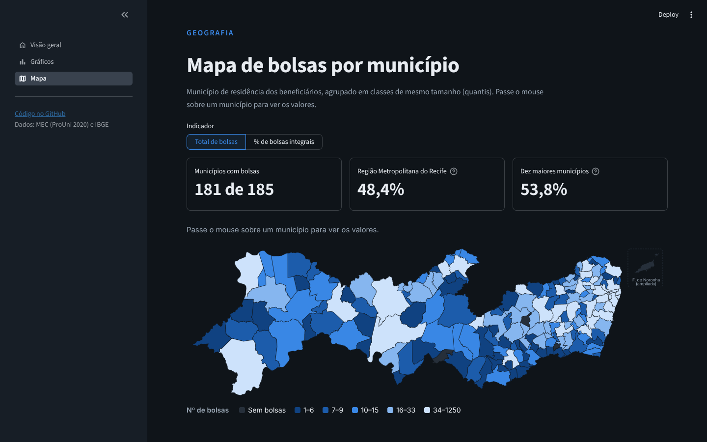

# Análise de Bolsas do ProUni em Pernambuco (2020)

[](https://prouni-pe-analysis.streamlit.app/)


Dashboard interativo que analisa a distribuição de bolsas do **ProUni** em **Pernambuco** em 2020, com recortes de tipo de bolsa, raça/cor, sexo e deficiência física, além de uma visão geoespacial por município.

**Demo:** https://prouni-pe-analysis.streamlit.app/

> Apps no Streamlit Community Cloud hibernam após um tempo sem acessos. Se aparecer a tela de "wake up", basta clicar no botão e aguardar alguns segundos.



---

## Pergunta de pesquisa

Como as bolsas do ProUni estão distribuídas em Pernambuco entre perfis de beneficiários e entre municípios, e como esse cenário se compara ao do Brasil?

## Principais achados

- **Tipo de bolsa:** a distribuição entre bolsas integrais e parciais em PE é comparável à nacional (ver gráfico na página *Gráficos*).
- **Raça/cor:** pessoas autodeclaradas pardas formam o maior grupo, seguidas por brancas e pretas.
- **Sexo:** mulheres concentram a maior parcela das bolsas.
- **Geografia:** há forte concentração na Região Metropolitana do Recife, com polos no interior (ex.: Caruaru e Petrolina).

## Funcionalidades

| Página | O que mostra |
|---|---|
| **Visão geral** | Indicadores-chave (com comparação ao Brasil), achados calculados a partir dos dados e notas de método |
| **Gráficos** | Brasil × PE (tipo de bolsa, modalidade), turno, perfil por raça/cor, sexo, faixa etária e deficiência, ranking de municípios; filtros por modalidade e tipo de bolsa |
| **Mapa** | Mapa interativo dos 185 municípios por nº de bolsas ou % de bolsas integrais (classes por quantis), com ranking pesquisável |

## Dados e metodologia

**Fontes**

- **Bolsas ProUni 2020:** dados abertos do MEC (`ProuniRelatorioDadosAbertos2020.csv`). Fonte: [`2020 - Bolsas concedidas e perfil dos beneficiários do Prouni`](https://dadosabertos.mec.gov.br/prouni). Baixado em `2026-04-18`.
- **Malha municipal de PE:** IBGE (`PE_Municipios_2025.shp`). Fonte: [`2025 - Malha Municipal/Municípios de Pernambuco`](https://www.ibge.gov.br/geociencias/organizacao-do-territorio/malhas-territoriais).

**Tratamento**

1. Leitura do CSV (`;`, `latin1`) apenas das colunas necessárias. O CPF (já mascarado na fonte) não é carregado.
2. Correção de rótulos de um arquivo com codificação mista (ex.: `Ind¡gena` → `Indígena`).
3. Normalização de nomes de municípios (sem acento, maiúsculas) e reconciliação de quatro grafias divergentes entre MEC e IBGE (Iguaraci, Itamaracá, Belém de São Francisco, Lagoa do Itaenga). Um teste garante que 100% das bolsas casam com a malha.
4. Idade aproximada (2020 − ano de nascimento); datas implausíveis são descartadas.
5. Fernando de Noronha é desenhada em um quadro de detalhe no mapa, para não distorcer a escala do continente.

### Limitações

- Os dados cobrem **apenas bolsas concedidas** em 2020, sem candidatos nem elegíveis. Não permitem concluir sobre acesso ou equidade do programa.
- O município é o de **residência do beneficiário**, não o da instituição de ensino.
- Contagens são absolutas e refletem, em parte, o tamanho da população de cada município. Uma versão *per capita* é um próximo passo.
- A coluna de deficiência refere-se a **deficiência física**, não a todas as pessoas com deficiência.

## Estrutura do projeto

```
.
├── app.py                  # ponto de entrada: página, tema e navegação
├── views/                  # páginas do Streamlit
│   ├── home.py
│   ├── graficos.py
│   └── mapa.py
├── src/prouni/
│   ├── constants.py        # caminhos, paleta, ordens de categorias, RMR, aliases
│   ├── data.py             # leitura, limpeza e cache dos dados
│   ├── geo.py              # malha IBGE, resumo por município, classes de quantis
│   ├── plots.py            # gráficos (Plotly)
│   ├── svgmap.py           # mapa coroplético em SVG responsivo
│   ├── formatting.py       # números no padrão brasileiro
│   └── ui.py               # CSS e componentes compartilhados
├── data/raw/               # CSV do MEC e shapefile do IBGE (data/raw/mapa)
├── docs/img/    
├── notebooks/analise.ipynb # exploração original
├── tests/                  # dados, merge com a malha e fumaça das páginas
├── .streamlit/config.toml  # tema
├── .github/workflows/ci.yml
├── pyproject.toml          # ruff e pytest
├── requirements.txt        # dependências do app
└── requirements-dev.txt    # + pytest e ruff
```

## Como rodar localmente

Requisitos: Python 3.11 ou superior.

```bash
# 1. Clonar
git clone https://github.com/jpedrosmenezes/prouni-geo-pe.git
cd prouni-geo-pe

# 2. Ambiente virtual
python -m venv .venv
source .venv/bin/activate        # Windows: .venv\Scripts\activate

# 3. Dependências
pip install -r requirements.txt

# 4. Executar
streamlit run app.py
```

O app abre em `http://localhost:8501`.

## Testes e qualidade

```bash
pip install -r requirements-dev.txt
ruff check .
python -m pytest
```

## Tecnologias

- **Python**, **Pandas** e **GeoPandas** para dados e geoprocessamento
- **Plotly** para gráficos interativos
- **SVG + CSS** gerados em Python para o mapa (sem WebGL nem CDN)
- **Streamlit** para a interface
- **pytest** e **ruff**, com CI no GitHub Actions

## Próximos passos

- [ ] Normalizar bolsas por população (bolsas por mil habitantes)
- [x] Mapa interativo com tooltip (município e total)
- [x] Filtros por tipo de bolsa e modalidade
- [ ] Incluir outros anos do ProUni e comparar a evolução
- [x] Testes automatizados do merge de municípios

## Licença e fontes

- **Código:** [MIT](LICENSE) © 2026 João Pedro S. Menezes
- **Dados:** mantêm as licenças e termos de uso das fontes originais citadas acima.
